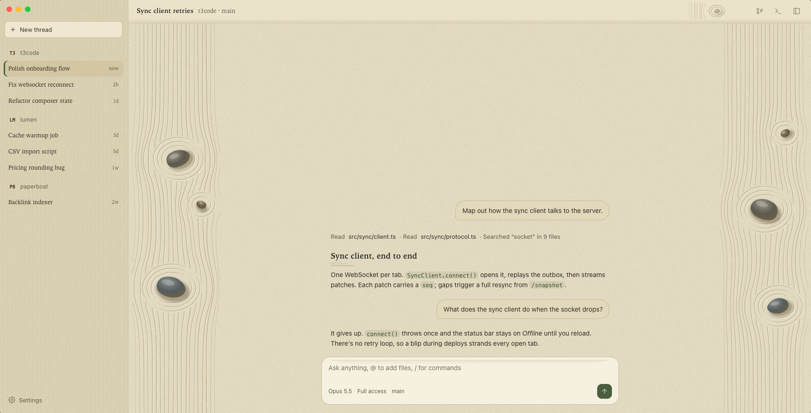

# Sandgarden

A calm, light theme for T3 Code: a dry rock garden. Raked sand, quiet stones, moss ink. While the agent works, a rake draws furrows down the margins; when it stops they settle into ripples and the sand goes still.



Live page: https://joshsaintjacque.github.io/t3code-theme-sandgarden/

## Install

1. **In the app:** copy the contents of [`sandgarden.json`](sandgarden.json), then open Settings › Appearance › Add theme and paste.
2. **CLI:**
```sh
curl -fsSL -o sandgarden.json https://joshsaintjacque.github.io/t3code-theme-sandgarden/sandgarden.json
~/.t3/bin/t3 theme set sandgarden.json
```

## What moves

| State | Motion |
|---|---|
| Idle | Furrows set, stones ringed. Still. |
| Turn running | Moss furrows are raked into each margin five at a time over ~20s (each moss line replaces its sand furrow), then the garden holds, its rings breathing slowly. A short tine walks the header rail once; the header garden and the composer furrows turn moss. In windows with narrow margins a slim full-height strip with one stone in each margin turns moss as well. |
| Working row | Three wavy furrows flow underneath. |
| Background thread busy | The same furrows, slower, under that thread. |
| Composer focus | Two soft ripples spread from the composer edge. |
| Thread hover | Three tines are drawn under the row. |
| Turn complete | The moss fades into the sand (about 1.6s), each ring set spreading from its stone, and the header garden folds away to the left while the tine shrinks where it stands. An early finish fades only what was drawn. |
| Narrow gutters | The margin strips step aside when a gutter is under ~220px; a slim full-height strip (about 72px, one stone) takes over each margin and turns moss while working; the header garden and composer furrows also mark the state. |
| Reduced motion | Everything stops; a running turn shows the finished moss garden as a still, and busy rows keep static wavy furrows. |

## Palette (key roles)

| Role | Hex |
|---|---|
| `canvas` | `#f1e9d6` |
| `chrome` | `#e8dec6` |
| `surface` | `#f7f1e2` |
| `sidebar` | `#e7ddc4` |
| `messageSurface` | `#e3d8bc` |
| `codeBackground` | `#e9e0c8` |
| `text` | `#2b2822` |
| `textMuted` | `#5b5546` |
| `accent` | `#4a5e3e` |
| `accentForeground` | `#f7f2e3` |
| `error` | `#a23a2c` |
| `warning` | `#8a6212` |
| `update` | `#3a6470` |
| `border` | `#cfc1a0` |

All 61 roles are set in the file. Contrast: text on canvas 12.2:1, muted text 6.1:1, accent text 6.3:1.

## Build

```sh
python3 source/build.py   # writes sandgarden.json and assets/svg/*
python3 source/site.py    # writes index.html from the theme file
```

MIT. Not affiliated with T3.
